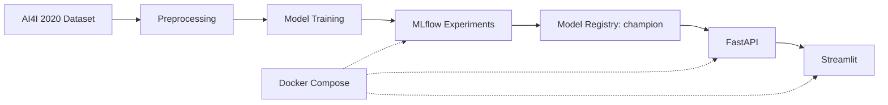

# ⚙️ MLflowOps — Predictive Maintenance Intelligence

**End-to-end MLOps for industrial machine failure prediction.**

**Stack:** Python · XGBoost · MLflow · FastAPI · Streamlit · Docker

## Overview

MLflowOps demonstrates the machine-learning lifecycle from data preparation and model evaluation to experiment tracking, model registration, REST inference, and an interactive dashboard. It uses the **AI4I 2020 Predictive Maintenance** dataset.

## Architecture



## Model Performance

The selected champion model is **XGBoost**.

| Metric | Test result |
|---|---:|
| Accuracy | 98.47% |
| F1-score | 0.7629 |
| ROC-AUC | 0.9708 |
| Decision threshold | 0.3113 |
| Registered model version | 1 |

These metrics are from the project's test evaluation, not validation on live industrial machinery.

**Inputs:** machine type (L/M/H), air temperature, process temperature, rotational speed, torque, and tool wear.

## Features

- **MLflow tracking:** Compare Logistic Regression, Random Forest, and XGBoost experiments.
- **Model Registry:** Load `MLflowOps-Predictive-Maintenance@champion` and its stored decision threshold.
- **FastAPI:** Serve `/health`, `/predict`, and interactive `/docs`.
- **Streamlit:** Enter machine measurements and inspect predicted failure probability and risk level.
- **Docker Compose:** Run MLflow, API, and dashboard as separate services.

## API Example

```bash
curl -X POST http://localhost:8000/predict \
  -H "Content-Type: application/json" \
  -d '{
    "machine_type": "M",
    "air_temperature": 298.1,
    "process_temperature": 308.6,
    "rotational_speed": 1551,
    "torque": 42.8,
    "tool_wear": 0
  }'
```

Example response from the local deployment:

```json
{
  "prediction": 0,
  "failure_probability": 0.0001,
  "decision_threshold": 0.31126633286476135,
  "risk_level": "LOW",
  "model_name": "MLflowOps-Predictive-Maintenance",
  "model_version": "1",
  "timestamp": "2026-10-28T17:51:16.379040+00:00"
}
```

## Docker Services

| Service | Local address |
|---|---|
| Streamlit dashboard | `http://localhost:8501` |
| FastAPI documentation | `http://localhost:8000/docs` |
| MLflow UI | `http://localhost:5050` |

```bash
docker compose up -d --build
```

**Reproducibility note:** The current Compose setup was tested locally with an existing MLflow database and model artifacts, which are intentionally excluded from Git. It also contains a Mac-specific artifact compatibility mount. A fresh clone is **not yet ready for predictions** until artifact paths are made portable and the champion model is trained and registered.

## Project Structure

```text
MLflowOps/
├── api/main.py
├── dashboard/app.py
├── src/
│   ├── download_data.py
│   ├── preprocess.py
│   ├── train.py
│   ├── optimize_threshold.py
│   └── register_model.py
├── assets/
├── first_experiment.py
├── Dockerfile
├── compose.yaml
├── requirements.txt
└── README.md
```

## Screenshots

Screenshots of the Streamlit dashboard, predictions, and MLflow experiments will be added to `assets/`.

## Roadmap

- [x] Model training and evaluation
- [x] MLflow experiment tracking and champion registration
- [x] FastAPI prediction service
- [x] Streamlit dashboard
- [x] Local Docker deployment
- [ ] Portable MLflow artifacts and reproducible initialization
- [ ] Pytest automated tests
- [ ] GitHub Actions CI/CD
- [ ] Monitoring and logging
- [ ] Dashboard screenshots

## Author

**Youssef MOUHI** — Data Science & Artificial Intelligence

[GitHub](https://github.com/YoussefMouhi) · [Portfolio](https://youssef-mouhi-portfolio.vercel.app)

---

**MLflowOps — From Machine Learning Experiments to Deployed Intelligence**
