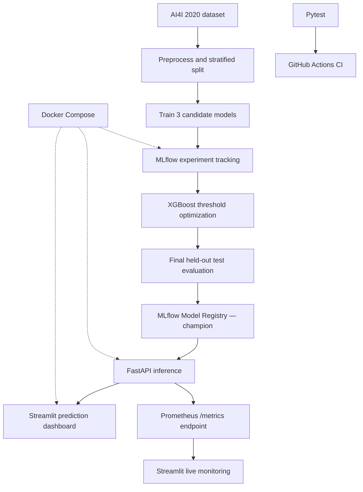
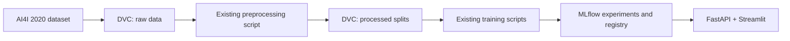

# ⚙️ MLflowOps — Predictive Maintenance Intelligence

<p align="center">
  
</p>


[](https://github.com/YoussefMouhi/MLflowOps/actions/workflows/ci.yml)


**An end-to-end MLOps project for machine-failure risk prediction, with tracked experiments, champion model serving, API observability, and automated CI.**

> **Demonstration only:** Trained on the AI4I 2020 synthetic predictive maintenance dataset. The predictions have not been validated for real-world industrial safety decisions.

## What this project delivers

MLflowOps implements a model lifecycle rather than a standalone notebook:

- **Data preparation:** AI4I 2020 data download, feature selection, stratified training/validation/test splits (70% / 15% / 15%).
- **Experiment tracking:** Logistic Regression, Random Forest, and XGBoost experiments logged to MLflow, including validation metrics and evaluation plots.
- **Model selection:** XGBoost candidate with an optimized decision threshold derived from validation data.
- **Model Registry:** Versioned `MLflowOps-Predictive-Maintenance` model published under the `champion` alias.
- **Serving:** FastAPI exposes validation, health checks, probability-based inference, and Prometheus-format metrics.
- **User interface:** Streamlit machine-configuration form, probability visualization, model decision and live monitoring section.
- **Quality checks:** Pytest unit and mocked HTTP endpoint tests run automatically through GitHub Actions.

## Architecture



## Champion model results

The locally evaluated champion was **XGBoost** (registered model version **1**).

| Held-out test metric | Result |
|:--|--:|
| Accuracy | **98.47%** |
| F1-score | **0.7629** |
| ROC-AUC | **0.9708** |
| Optimized decision threshold | **0.3113** |

These are results from the project's synthetic dataset, not measurements on real production equipment. The threshold is used to convert estimated failure probability into a binary prediction. The API additionally reports `LOW`, `MODERATE`, or `HIGH` risk.

**Model features:** Type (`L`, `M`, `H`), air temperature (K), process temperature (K), rotational speed (RPM), torque (Nm), and tool wear (minutes).

## Live dashboard

The Streamlit interface has three main sections:

1. **Machine Configuration:** Supply operating conditions and submit a prediction.
2. **Prediction Intelligence:** View probability, decision threshold, risk level, model version, and response details.
3. **Live System Monitoring:** Inspect request counts, mean observed inference latency, risk distribution, and error metrics.

The monitoring panel reads the FastAPI `/metrics` endpoint and provides a manual **Refresh Monitoring Metrics** action.

### Observability

| Metric | Interpretation |
|:--|:--|
| `mlflowops_predictions_total` | Successful predictions |
| `mlflowops_prediction_latency_seconds` | Inference-duration histogram |
| `mlflowops_prediction_risk_total{risk_level="..."}` | Successful predictions grouped by risk |
| `mlflowops_prediction_errors_total` | Defined failure counter; **not yet incremented by error-handling code** |

**Monitoring limitations:** Metrics currently live in the API process memory, so they reset when the process restarts. The dashboard's error count and error rate do not yet capture actual inference failures. The latency histogram measures the timed prediction section, not complete HTTP response time. No long-term Prometheus scraping service is configured in the current Compose stack.

## REST API

| Endpoint | Method | Description |
|:--|:--|:--|
| `/` | GET | Service information |
| `/health` | GET | API/model availability and version |
| `/predict` | POST | Estimated failure probability and decision |
| `/metrics` | GET | Prometheus text exposition |
| `/docs` | GET | Interactive OpenAPI documentation |

**Example request**

```bash
curl -s -X POST http://localhost:8000/predict \
  -H "Content-Type: application/json" \
  -d '{
    "machine_type": "M",
    "air_temperature": 298.1,
    "process_temperature": 308.6,
    "rotational_speed": 1551,
    "torque": 42.8,
    "tool_wear": 0
  }'
```

Example from the locally running champion model (timestamp omitted):

```json
{
  "prediction": 0,
  "failure_probability": 0.0001,
  "decision_threshold": 0.31126633286476135,
  "risk_level": "LOW",
  "model_name": "MLflowOps-Predictive-Maintenance",
  "model_version": "1"
}
```

The real response also includes an ISO-8601 `timestamp`.

## Running the existing local deployment

**Requirements:** Docker and Docker Compose, plus a locally initialized MLflow registry with the champion model and its artifacts.

```bash
docker compose up -d
docker compose ps
```

| Service | Address |
|:--|:--|
| Streamlit | http://localhost:8501 |
| FastAPI docs | http://localhost:8000/docs |
| FastAPI health | http://localhost:8000/health |
| API metrics | http://localhost:8000/metrics |
| MLflow tracking UI | http://localhost:5050 |

> **Important reproducibility limitation:** The current `compose.yaml` references locally persisted MLflow data and includes a legacy host-path compatibility mount. The SQLite database, model artifacts, and datasets are excluded from Git. Running `docker compose up` from a fresh clone **does not automatically produce a serving champion model**. Fully portable artifact storage and first-run initialization remain unverified. Do not delete existing `mlflow.db`, `mlartifacts/`, or the working local deployment to test this.

### Experiment pipeline (existing initialized environment)

The repository contains the stage scripts:

```bash
python -m src.download_data
python -m src.preprocess
python -m src.train
python -m src.optimize_threshold
python -m src.register_model
```

These scripts assume a reachable MLflow server and write data/artifacts locally. In the existing host setup, the scripts default to `http://127.0.0.1:5050` where configured; inside Docker, use the service URL `http://mlflow:5000`. Threshold optimization and registration select the latest run named `XGBoost`; registration checks that the saved threshold references that same run. They are not yet a one-command portable bootstrap flow.

## DVC dataset versioning — planned integration

**Status: Not implemented yet.** The repository currently excludes `data/raw/` and `data/processed/` from Git and does not yet contain DVC metadata or a configured DVC remote. The commands below are an implementation plan, not a tested workflow.

DVC will complement, not replace, MLflow:

| Tool | Responsibility |
|:--|:--|
| Git | Source code, DVC pointer files, configuration |
| DVC | Version the AI4I 2020 raw dataset and deterministic train/validation/test splits |
| MLflow | Experiments, metrics, model artifacts, model registry |
| Docker Compose | Existing MLflow, API and dashboard services |

### Intended data flow



### Initial local setup (run after confirming dataset paths)

Create a feature branch, install DVC in the host Python environment, and initialize it at the repository root:

```bash
git switch -c feature/dvc-data-versioning
python -m pip install "dvc>=3,<4"
dvc init
```

The existing pipeline generates the expected source files with:

```bash
python -m src.download_data
python -m src.preprocess
```

Verify that `data/raw/ai4i2020.csv` and `data/processed/{train,validation,test}.csv` exist before continuing. The repository currently ignores both data directories; replace those two broad Git ignore rules with DVC-managed ignores when running `dvc add`. Never commit raw CSV contents or secrets.

```bash
dvc add data/raw
dvc add data/processed
dvc status
```

Use a DVC remote **outside the Git working tree** for the initial local proof of concept:

```bash
mkdir -p "$HOME/dvc-storage/mlflowops"
dvc remote add --local -d storage "$HOME/dvc-storage/mlflowops"
dvc push
```

A local remote is not shared with other developers or CI. For reproducibility from a fresh clone, a properly permissioned remote must later be configured and tested using `dvc pull`. Do not publish remote credentials or restricted dataset contents.

### Planned validation and next stages

1. Confirm `dvc status` and `dvc push` succeed while the existing MLflow service remains unchanged.
2. Run the existing Pytest suite; verify that inference still works against the pre-existing champion model.
3. Add `dvc.yaml` and `dvc.lock` only after reviewing which stages are deterministic and where their outputs live. Do not accidentally run model registration as a side effect of ordinary DVC data reproduction.
4. Log the dataset revision or DVC lockfile hash as an MLflow run tag to link training experiments to exact data versions.
5. Verify the new workflow from a clean clone with a permitted remote and add targeted CI checks.

**Preservation rule:** Do not delete or regenerate the existing `mlflow.db`, `mlartifacts/`, `mlruns/` or registered champion model when integrating DVC.

## Testing and Continuous Integration

Tests are designed to run **without retraining or starting MLflow**, by mocking champion model loading in HTTP endpoint tests.

```bash
python -m pip install -r requirements.txt
python -m pytest tests/ -v
```

**Verified locally:** 12 tests passed, covering request/response schemas, invalid inputs, home/health/prediction endpoints, and Prometheus metrics. The GitHub Actions workflow `.github/workflows/ci.yml` installs dependencies with Python 3.12, checks Python syntax, and runs Pytest on configured pushes and pull requests. This is **CI**, not automatic production deployment.

## Repository layout

```text
MLflowOps/
├── .github/workflows/ci.yml
├── api/
│   ├── main.py
│   └── monitoring.py
├── dashboard/app.py
├── src/
│   ├── download_data.py
│   ├── preprocess.py
│   ├── train.py
│   ├── optimize_threshold.py
│   └── register_model.py
├── tests/
│   ├── test_api.py
│   ├── test_endpoints.py
│   └── test_monitoring.py
├── assets/
├── Dockerfile
├── compose.yaml
├── requirements.txt
└── README.md
```

## Delivery status and next improvements

| Capability | Status |
|:--|:--|
| MLflow experiments, champion registry, REST inference | ✅ Implemented and locally verified |
| Docker-based MLflow / API / dashboard | ✅ Verified using existing local artifacts |
| Pytest suite | ✅ 12 local tests passed |
| GitHub Actions CI | ✅ Workflow runs passed |
| DVC dataset versioning | 🛠️ Planned; not yet implemented |
| Prometheus metric exposition | ✅ Verified with a live prediction |
| Streamlit monitoring dashboard | ✅ Verified visually |

## Author

**Youssef MOUHI** — Data Science & Artificial Intelligence

[GitHub](https://github.com/YoussefMouhi)

---

*MLflowOps — From machine-learning experiments to deployed intelligence.*
