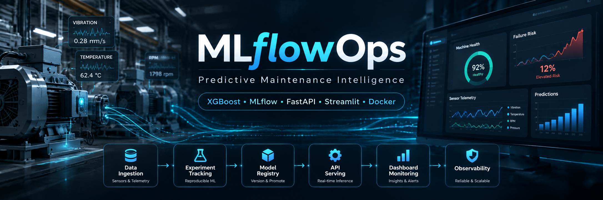
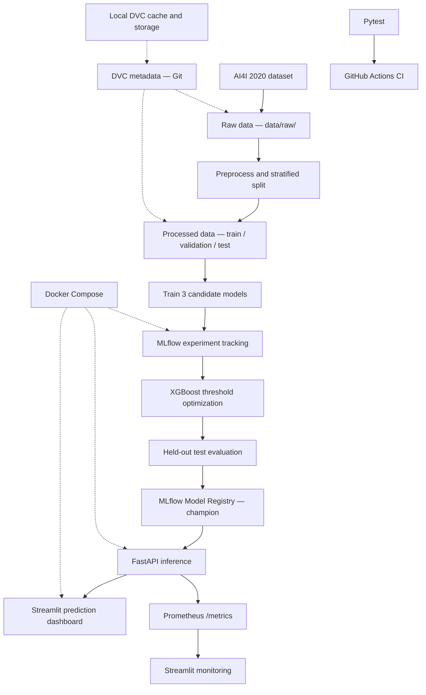
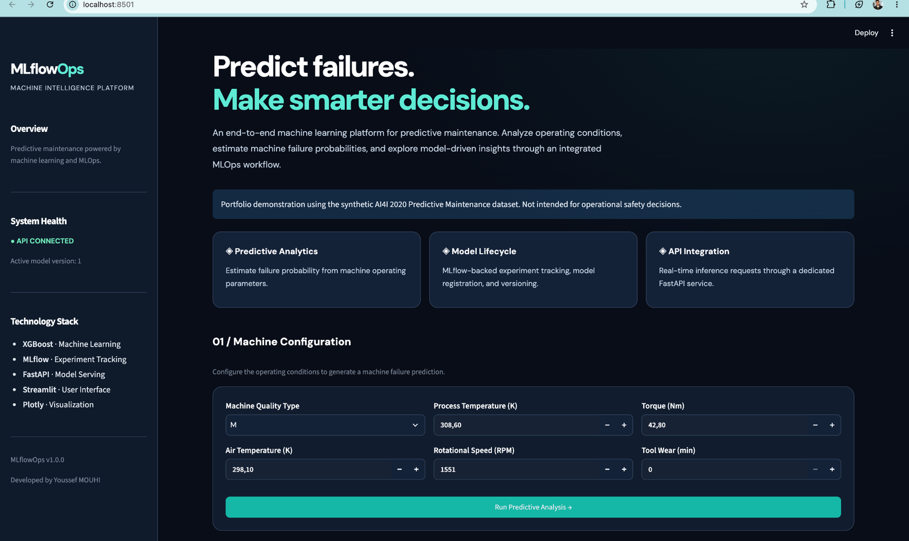
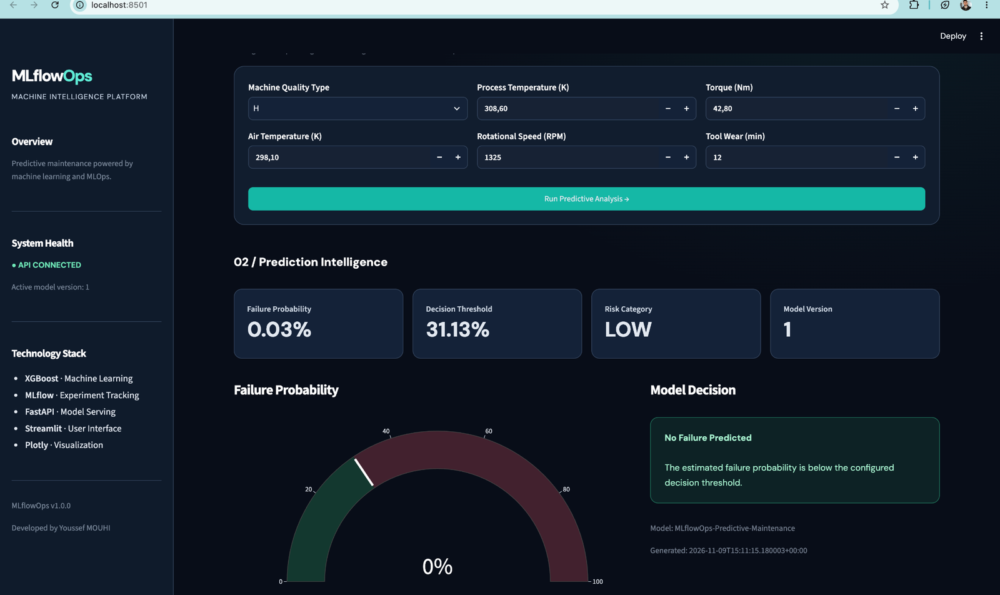
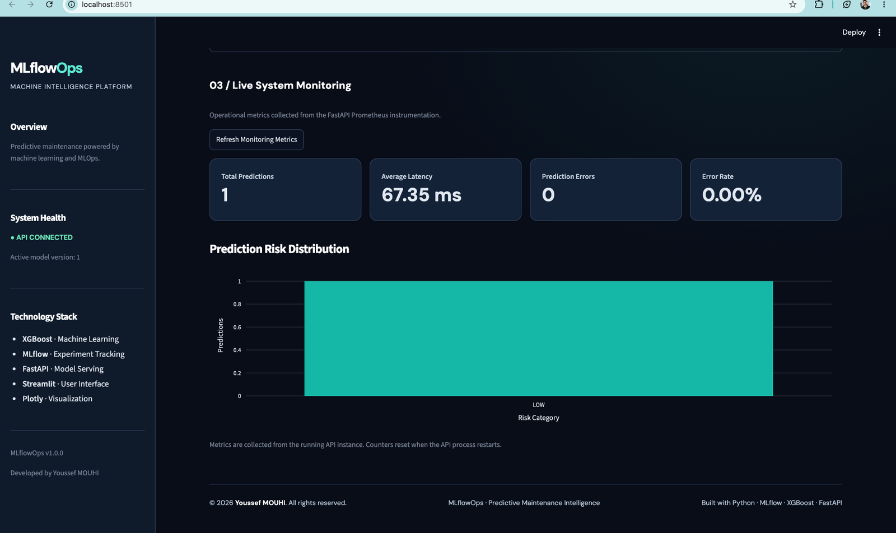
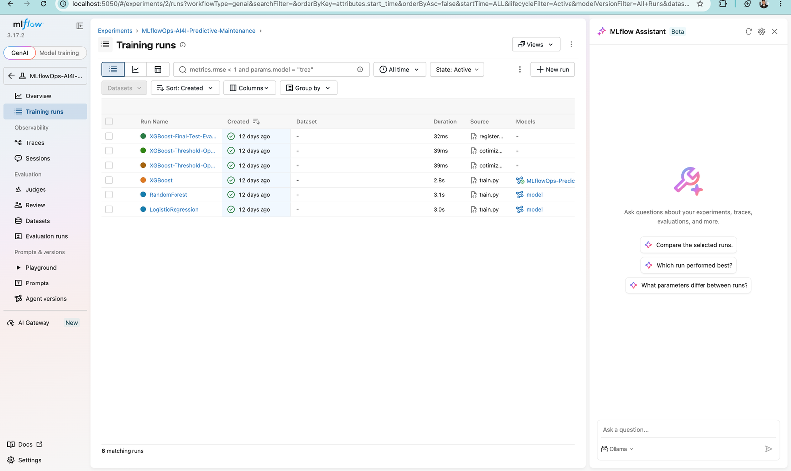
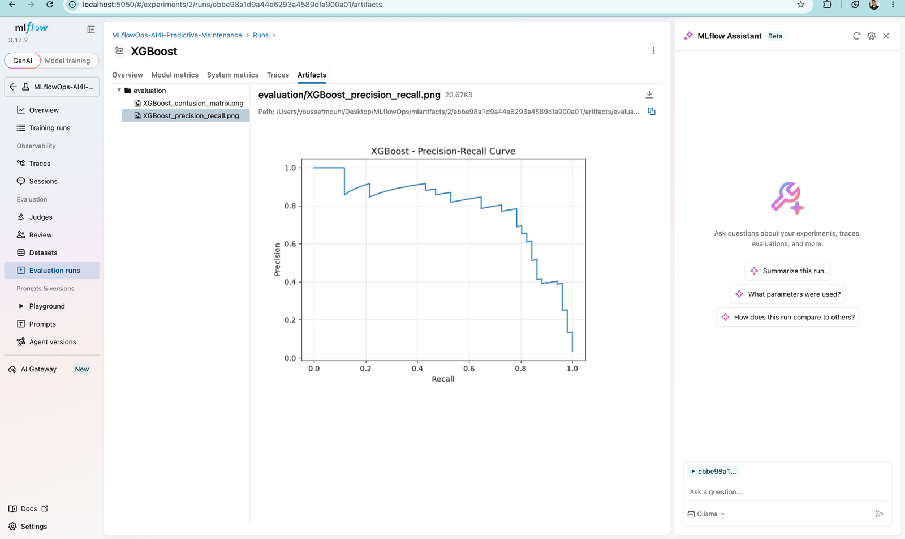
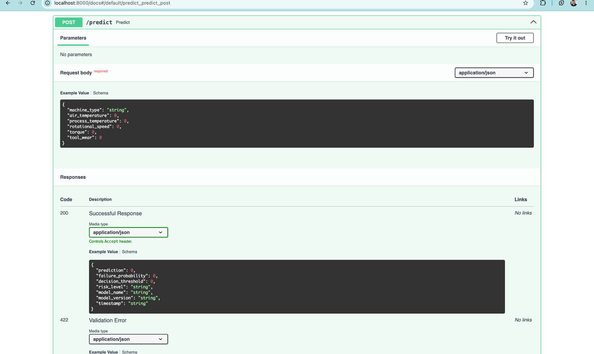
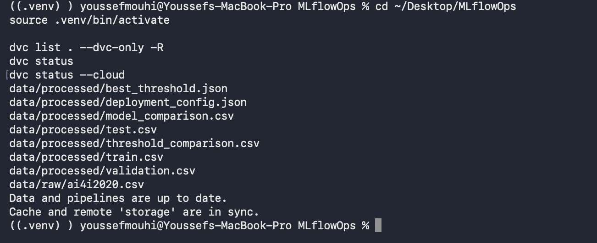
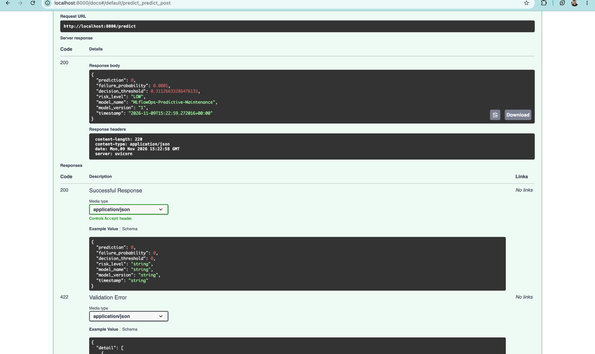

# ⚙️ MLflowOps — Predictive Maintenance Intelligence

<p align="center">
  
</p>


[](https://github.com/YoussefMouhi/MLflowOps/actions/workflows/ci.yml)


**An end-to-end MLOps project for machine-failure risk prediction, with tracked experiments, champion model serving, API observability, and automated CI.**

**DVC integration:** Raw AI4I data and processed datasets are now versioned with DVC metadata in Git. The initial DVC remote is **local to the developer's Mac**, not a shared cloud store. DVC pipeline automation and linking dataset revisions to MLflow runs remain planned. [See DVC details](#dvc-dataset-versioning).

> **Demonstration only:** Trained on the AI4I 2020 synthetic predictive maintenance dataset. The predictions have not been validated for real-world industrial safety decisions.

## What this project delivers

MLflowOps implements a model lifecycle rather than a standalone notebook:

- **Data preparation:** AI4I 2020 data download, feature selection, stratified training/validation/test splits (70% / 15% / 15%).
- **Dataset versioning:** DVC tracks the raw dataset and processed datasets using `data/raw.dvc` and `data/processed.dvc`.
- **Experiment tracking:** Logistic Regression, Random Forest, and XGBoost experiments logged to MLflow, including validation metrics and evaluation plots.
- **Model selection:** XGBoost candidate with an optimized decision threshold derived from validation data.
- **Model Registry:** Versioned `MLflowOps-Predictive-Maintenance` model published under the `champion` alias.
- **Serving:** FastAPI exposes validation, health checks, probability-based inference, and Prometheus-format metrics.
- **User interface:** Streamlit machine-configuration form, probability visualization, model decision and live monitoring section.
- **Quality checks:** Pytest unit and mocked HTTP endpoint tests run automatically through GitHub Actions.

## Architecture



**Reproducibility boundary:** DVC pointer files are committed in Git, but the DVC remote configured during initial development is stored locally on the developer's Mac. Reproducing datasets on another machine still requires a shared permitted remote and access to the dataset contents. MLflow model artifacts and the existing local champion registry are managed separately.

## Champion model results

The locally evaluated champion was **XGBoost** (registered model version **1**).

| Held-out test metric | Result |
|:--|--:|
| Accuracy | **98.47%** |
| F1-score | **0.7629** |
| ROC-AUC | **0.9708** |
| Optimized decision threshold | **0.3113** |

These are results from the project's synthetic dataset, not measurements on real production equipment. The threshold is used to convert estimated failure probability into a binary prediction. The API additionally reports `LOW`, `MODERATE`, or `HIGH` risk.

**Model features:** Type (`L`, `M`, `H`), air temperature (K), process temperature (K), rotational speed (RPM), torque (Nm), and tool wear (minutes).

## Live dashboard

The Streamlit interface has three main sections:

1. **Machine Configuration:** Supply operating conditions and submit a prediction.
2. **Prediction Intelligence:** View probability, decision threshold, risk level, model version, and response details.
3. **Live System Monitoring:** Inspect request counts, mean observed inference latency, risk distribution, and error metrics.

The monitoring panel reads the FastAPI `/metrics` endpoint and provides a manual **Refresh Monitoring Metrics** action.

### Observability

| Metric | Interpretation |
|:--|:--|
| `mlflowops_predictions_total` | Successful predictions |
| `mlflowops_prediction_latency_seconds` | Inference-duration histogram |
| `mlflowops_prediction_risk_total{risk_level="..."}` | Successful predictions grouped by risk |
| `mlflowops_prediction_errors_total` | Defined failure counter; **not yet incremented by error-handling code** |

**Monitoring limitations:** Metrics currently live in the API process memory, so they reset when the process restarts. The dashboard's error count and error rate do not yet capture actual inference failures. The latency histogram measures the timed prediction section, not complete HTTP response time. No long-term Prometheus scraping service is configured in the current Compose stack.

## REST API

| Endpoint | Method | Description |
|:--|:--|:--|
| `/` | GET | Service information |
| `/health` | GET | API/model availability and version |
| `/predict` | POST | Estimated failure probability and decision |
| `/metrics` | GET | Prometheus text exposition |
| `/docs` | GET | Interactive OpenAPI documentation |

**Example request**

```bash
curl -s -X POST http://localhost:8000/predict \
  -H "Content-Type: application/json" \
  -d '{
    "machine_type": "M",
    "air_temperature": 298.1,
    "process_temperature": 308.6,
    "rotational_speed": 1551,
    "torque": 42.8,
    "tool_wear": 0
  }'
```

Example from the locally running champion model (timestamp omitted):

```json
{
  "prediction": 0,
  "failure_probability": 0.0001,
  "decision_threshold": 0.31126633286476135,
  "risk_level": "LOW",
  "model_name": "MLflowOps-Predictive-Maintenance",
  "model_version": "1"
}
```

The real response also includes an ISO-8601 `timestamp`.

## Running the existing local deployment

**Requirements:** Docker and Docker Compose, plus a locally initialized MLflow registry with the champion model and its artifacts.

```bash
docker compose up -d
docker compose ps
```

| Service | Address |
|:--|:--|
| Streamlit | http://localhost:8501 |
| FastAPI docs | http://localhost:8000/docs |
| FastAPI health | http://localhost:8000/health |
| API metrics | http://localhost:8000/metrics |
| MLflow tracking UI | http://localhost:5050 |

> **Important reproducibility limitation:** The current `compose.yaml` references locally persisted MLflow data and includes a legacy host-path compatibility mount. The SQLite database, model artifacts, and datasets are excluded from Git. Running `docker compose up` from a fresh clone **does not automatically produce a serving champion model**. Fully portable artifact storage and first-run initialization remain unverified. Do not delete existing `mlflow.db`, `mlartifacts/`, or the working local deployment to test this.

### Experiment pipeline (existing initialized environment)

The repository contains the stage scripts:

```bash
python -m src.download_data
python -m src.preprocess
python -m src.train
python -m src.optimize_threshold
python -m src.register_model
```

These scripts assume a reachable MLflow server and write data/artifacts locally. In the existing host setup, the scripts default to `http://127.0.0.1:5050` where configured; inside Docker, use the service URL `http://mlflow:5000`. Threshold optimization and registration select the latest run named `XGBoost`; registration checks that the saved threshold references that same run. They are not yet a one-command portable bootstrap flow.

## DVC dataset versioning

**Status: Implemented locally for dataset tracking.** DVC 3.67.1 was installed and initialized. Git now tracks `.dvc/`, `data/raw.dvc`, `data/processed.dvc`, and `data/.gitignore`. The contents of `data/raw/` and `data/processed/` are excluded from Git, and the two DVC pointer files describe their versioned contents.

The initial dataset version contains:

- **Raw:** `data/raw/ai4i2020.csv` — 10,000 rows, 12 columns.
- **Processed:** `train.csv` (7,000 samples), `validation.csv` (1,500), `test.csv` (1,500), plus four existing analysis/configuration outputs in `data/processed/`.

DVC complements MLflow: **DVC versions datasets; MLflow tracks experiments, metrics and registered models.** No existing model artifacts or MLflow registry entries were changed to add DVC.

### Storage and verification

During local setup, a private DVC remote was configured at `~/dvc-storage/mlflowops` using `dvc remote add --local`. The developer reported `dvc push` succeeded with **10 files pushed** and `dvc status` showed data up to date. The local remote path is **not committed**, intentionally; it is not accessible from a fresh clone or GitHub Actions.

The existing test suite also passed **12 tests** after DVC installation (one dependency deprecation warning). These checks do not prove that the data can be retrieved on a different machine.

For an already configured local clone:

```bash
dvc status
dvc push
python -m pytest tests/ -q
```

### Planned next improvements

1. Set up a permitted **shared DVC remote** and verify `dvc pull` from a clean clone.
2. Decide whether to track just training datasets or also intermediate evaluation files separately.
3. Create a carefully scoped `dvc.yaml` and `dvc.lock` for deterministic data preparation; keep model registration outside automatic data reproduction.
4. Log the dataset revision/hash to MLflow runs to link experiment metrics to the exact input data.
5. Add reproducibility checks to CI when a remote is available.

**Important:** Do not delete existing `mlflow.db`, `mlartifacts/`, `mlruns/`, or the registered `champion` model when extending DVC.

## Testing and Continuous Integration

Tests are designed to run **without retraining or starting MLflow**, by mocking champion model loading in HTTP endpoint tests.

```bash
python -m pip install -r requirements.txt
python -m pytest tests/ -v
```

**Verified locally:** 12 tests passed, covering request/response schemas, invalid inputs, home/health/prediction endpoints, and Prometheus metrics. The GitHub Actions workflow `.github/workflows/ci.yml` installs dependencies with Python 3.12, checks Python syntax, and runs Pytest on configured pushes and pull requests. This is **CI**, not automatic production deployment.

## Repository layout

```text
MLflowOps/
├── .github/workflows/ci.yml
├── .dvc/
├── .dvcignore
├── data/
│   ├── .gitignore
│   ├── raw.dvc
│   └── processed.dvc
├── api/
│   ├── main.py
│   └── monitoring.py
├── dashboard/app.py
├── src/
│   ├── download_data.py
│   ├── preprocess.py
│   ├── train.py
│   ├── optimize_threshold.py
│   └── register_model.py
├── tests/
│   ├── test_api.py
│   ├── test_endpoints.py
│   └── test_monitoring.py
├── assets/
├── Dockerfile
├── compose.yaml
├── requirements.txt
└── README.md
```

## Delivery status and next improvements

| Capability | Status |
|:--|:--|
| MLflow experiments, champion registry, REST inference | ✅ Implemented and locally verified |
| Docker-based MLflow / API / dashboard | ✅ Verified using existing local artifacts |
| Pytest suite | ✅ 12 local tests passed |
| GitHub Actions CI | ✅ Workflow runs passed |
| DVC dataset versioning | ✅ Raw and processed data tracked; 10 objects pushed to local remote |
| Portable DVC data recovery | 🛠️ Planned: shared remote and fresh-clone test |
| Prometheus metric exposition | ✅ Verified with a live prediction |
| Streamlit monitoring dashboard | ✅ Verified visually |

## Screenshots — Real application and MLOps evidence

The images below are captures from the local MLflowOps demonstration on **9 November 2026**, using the synthetic AI4I 2020 dataset. They are displayed directly in the README, without an expandable section. They do not represent a public production service.

### Streamlit dashboard



### Predictive intelligence — Champion XGBoost



### Live API monitoring



### MLflow — Experiment comparison



### MLflow — XGBoost validation



### MLflow — Champion model registry



### DVC — Dataset versioning



### FastAPI — Successful prediction



**Dataset and artifact availability:** Images are committed separately under `assets/screenshots/`. DVC tracks raw and processed data using a local remote; the model registry and trained artifacts also depend on the local environment. See [DVC dataset versioning](#dvc-dataset-versioning).

## Author

**Youssef MOUHI** — Data Science & Artificial Intelligence

[GitHub](https://github.com/YoussefMouhi)

---

*MLflowOps — From machine-learning experiments to deployed intelligence.*
